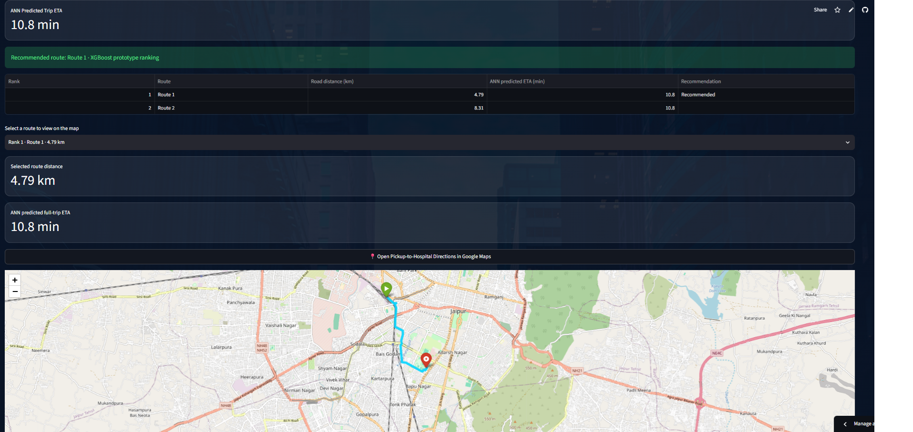

# 🚑 UrbanPulse — Emergency Hospital Finder & Route Planner

**An ML-powered prototype for hospital discovery, ETA prediction, and alternative route comparison.**

[](https://www.python.org/)
[](https://streamlit.io/)
[](https://xgboost.readthedocs.io/)
[](https://www.tensorflow.org/)

**🔗 GitHub Repository:** [UrbanPulse](https://github.com/Anujsharma-labs/urbanpulse)

---

## 📸 Application Preview



## 💡 Overview

UrbanPulse is a machine-learning-based prototype that helps users find hospitals, compare alternative driving routes, and estimate journey duration through an interactive web application.

## ✨ Key Features

- 🏥 Hospital discovery based on pickup location
- 🗺️ Alternative driving route comparison
- 🧠 ANN-based whole-journey ETA prediction
- ⚡ Experimental XGBoost-based route ranking
- 📍 Interactive map visualization
- 🌐 Streamlit web application

## 🛠️ Tech Stack

- **Programming:** Python
- **Machine Learning:** TensorFlow/Keras, XGBoost, Scikit-learn
- **Data Processing:** Pandas, NumPy
- **Database:** SQL Server
- **Web App:** Streamlit
- **Mapping & Routing:** Folium, OpenStreetMap, OSRM, Nominatim

## 🤖 Machine Learning

**ANN:** Estimates the duration of the complete pickup-to-hospital journey using distance and geographic coordinates.

**XGBoost:** Integrated experimentally to rank alternative routes using available model features. Route-ranking performance has not been independently validated.

## 🚀 Run Locally

```bash
git clone https://github.com/Anujsharma-labs/urbanpulse.git
cd urbanpulse
python -m venv .venv
```

Activate the environment, then install dependencies:

```bash
pip install -r requirements.txt
streamlit run app.py
```

Ensure all required model files exist at the paths configured in `app.py`.

## ⚠️ Limitations

- No live traffic integration.
- ETA and route ranking require further validation.
- Routing and geocoding depend on external services.
- This is a prototype, not a certified emergency dispatch system.

## 👨‍💻 Author

**Anuj Sharma**

Python | Machine Learning | SQL | Data Analytics

---

⭐ If you find this project interesting, consider starring the repository!
